<div align="center">


# EcoRide

**On-demand ride hailing for Pune: a rider app, a driver app and an admin console on one backend.**


[Demo videos](#demo-videos) · [Screenshots](#screenshots-step-by-step) · [Quick start](#quick-start) · [Architecture](docs/architecture.md)

</div>

---

## Table of contents

- [Overview](#overview)
- [Demo videos](#demo-videos)
- [Screenshots, step by step](#screenshots-step-by-step)
  - [1. Rider app](#1-rider-app)
  - [2. Driver app](#2-driver-app)
  - [3. Admin console](#3-admin-console)
- [How a ride works](#how-a-ride-works)
- [Quick start](#quick-start)
- [Demo accounts](#demo-accounts)
- [Testing](#testing)
- [Project structure](#project-structure)
- [Known limitations](#known-limitations)
- [Acknowledgements](#acknowledgements)

---

## Overview

EcoRide is an Uber-style system built by SRM ECO TECH as a working demo. Riders and drivers use **separate apps with separate accounts**; operations staff use a **web console with complete access**. Pickups come from the phone's GPS, every distance is measured along real roads, and the final fare is checked against the distance the cab actually drove.

| Part | What it does | Stack | Runs on |
|---|---|---|---|
| **Rider app** (`apps/rider`) | Sign up / sign in, GPS pickup, place search, upfront fares for Bike · Auto · Mini · Sedan · SUV, promo codes, UPI / cash / wallet, live tracking of the cab with road distance and ETA, PIN to start, SOS, share trip, receipt with the GPS distance check, rating and tip, ride history, wallet | Expo SDK 57, React Native, Expo Router, TanStack Query | Android / iOS (Expo Go) and web |
| **Driver app** (`apps/driver`) | Apply to drive (personal details → vehicle → licence), wait for approval, go online / offline, ride requests with a 15 s countdown, navigate to pickup, arrive (geofenced), start with the rider's PIN, drive, complete, collect cash, rate the rider, earnings and payouts; real GPS or a demo GPS simulator | Expo SDK 57 | Android / iOS (Expo Go) and web |
| **Admin console** (`apps/admin`) | Full access: dashboard, live map of every driver and ride, rides with planned-route-vs-GPS-trace, dispatch attempts and timeline, cancel and refund, driver approvals / suspensions / payouts, riders (block, wallet credit), fare cards with a calculator, surge zones, promotions, finance, SOS, settings, audit log, demo reset | React 19, Vite, Tailwind, Leaflet | Browser |
| **Backend** (`backend`) | Accounts and JWT per app, quotes and fares, dispatch, GPS ingestion and trip measurement, settlement, payments, ledger, admin APIs, demo data and a simulated fleet | Spring Boot 3.5, Java 21, MySQL 8 | `localhost:9080` |

Maps: **OpenStreetMap** tiles, **OSRM** road routing and **Nominatim** geocoding (all free, no API keys). If they are unreachable the backend falls back to straight-line estimates and curated Pune places, so booking never stops.

---

## Demo videos

One live ride, recorded as a separate video for each app: the rider and driver apps as full phone screens, the admin console as a desktop browser page. Select a thumbnail to open the video.

<table>
  <tr>
    <td align="center" valign="top">
      <a href="docs/demo/video/ecoride-rider.mp4">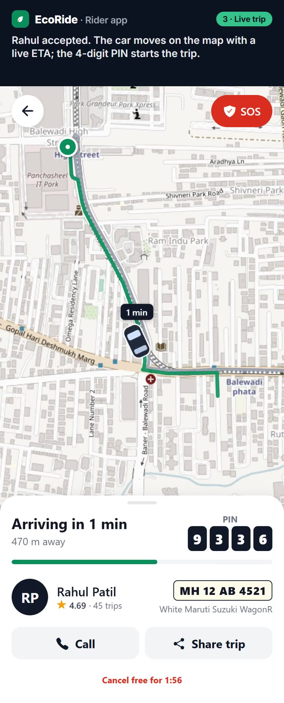</a><br>
      <b>▶ Rider app</b><br>
      <sub>Phone screen · 1:57 · 5 chapters</sub>
    </td>
    <td align="center" valign="top">
      <a href="docs/demo/video/ecoride-driver.mp4">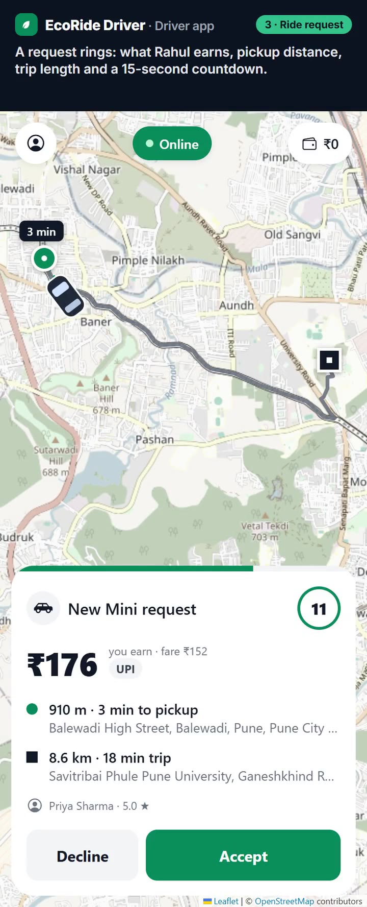</a><br>
      <b>▶ Driver app</b><br>
      <sub>Phone screen · 1:55 · 8 chapters</sub>
    </td>
    <td align="center" valign="top">
      <a href="docs/demo/video/ecoride-admin.mp4">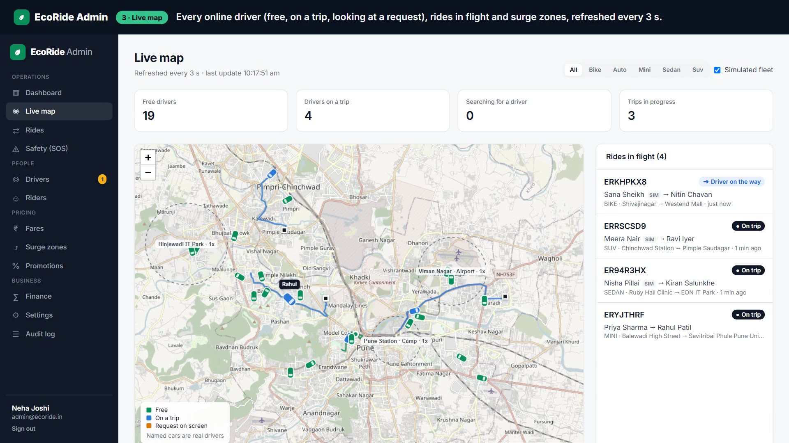</a><br>
      <b>▶ Admin console</b><br>
      <sub>Desktop browser · 1:14 · 8 chapters</sub>
    </td>
  </tr>
</table>

> For chapters you can jump to and enlargeable screenshots, open [`docs/demo/index.html`](docs/demo/index.html) in a browser.
>
> On a laptop the driver app replays the drive along the road route at 15× real time, and the middle of the drive to the drop plays faster again.

---

## Screenshots, step by step

Every screen below comes from the same recorded ride: **Priya Sharma** books a Mini from **Balewadi High Street** to **Savitribai Phule Pune University** with the `FIRST50` promo, **Rahul Patil** drives it, and the admin console follows it. Step codes match the demo page: **R** = rider, **D** = driver, **A** = admin.

### 1. Rider app

A new rider signs up, books from the phone's GPS location with an upfront fare and a promo, follows the cab live, starts the trip with a PIN, then rates and tips from a receipt that checks the fare against the GPS distance.

<sub>17 steps · [watch the rider app video](docs/demo/video/ecoride-rider.mp4) (1:57)</sub>

#### 1.1 Sign up

<table>
  <tr>
    <td align="center" valign="top" width="33%">
      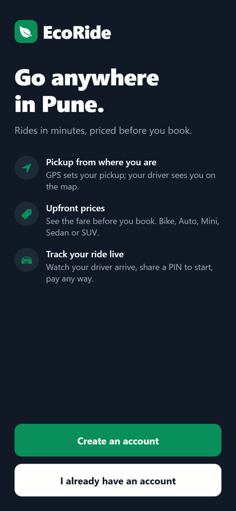<br>
      <b>R01 · Welcome</b><br>
      <sub>The rider app opens on a welcome screen with sign-up and sign-in.</sub>
    </td>
    <td align="center" valign="top" width="33%">
      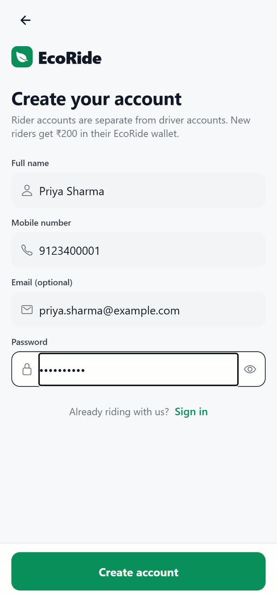<br>
      <b>R02 · Create an account</b><br>
      <sub>Sign-up asks for a name, an Indian mobile number, an optional email and a password (8+ characters).</sub>
    </td>
    <td align="center" valign="top" width="33%">
      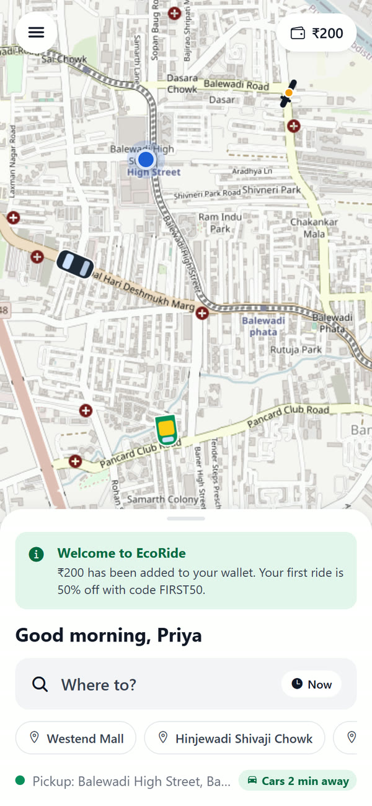<br>
      <b>R03 · Home: your location and cars nearby</b><br>
      <sub>The phone's GPS sets the pickup and labels it with the street. Free cars around the rider are drawn on the map and refresh every 5 s. A new rider gets ₹200 in the wallet and the FIRST50 code.</sub>
    </td>
  </tr>
</table>

#### 1.2 Book a ride

<table>
  <tr>
    <td align="center" valign="top" width="25%">
      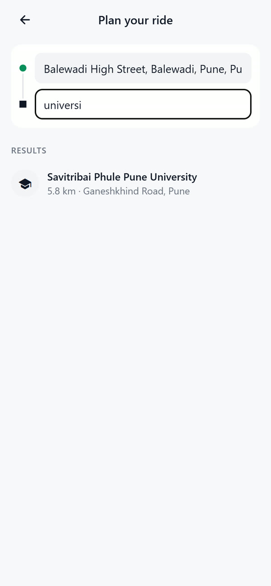<br>
      <b>R04 · Where to?</b><br>
      <sub>Search covers curated city places and OpenStreetMap addresses, with each result's distance from the pickup.</sub>
    </td>
    <td align="center" valign="top" width="25%">
      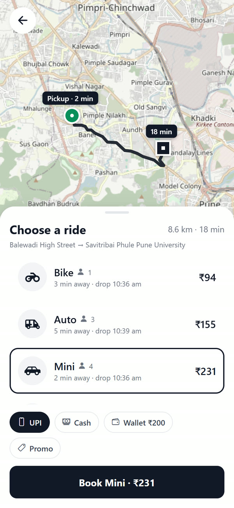<br>
      <b>R05 · Choose a ride: upfront fares</b><br>
      <sub>The road route (OSRM, OpenStreetMap) sets distance and time; every product shows its upfront fare and the nearest free car's ETA.</sub>
    </td>
    <td align="center" valign="top" width="25%">
      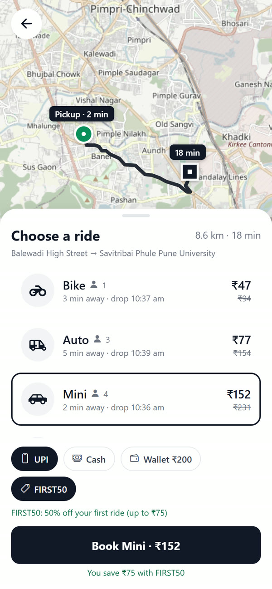<br>
      <b>R06 · Promo applied</b><br>
      <sub>The promo is checked on the server (validity, uses per rider, minimum fare) and the discounted fare replaces the price.</sub>
    </td>
    <td align="center" valign="top" width="25%">
      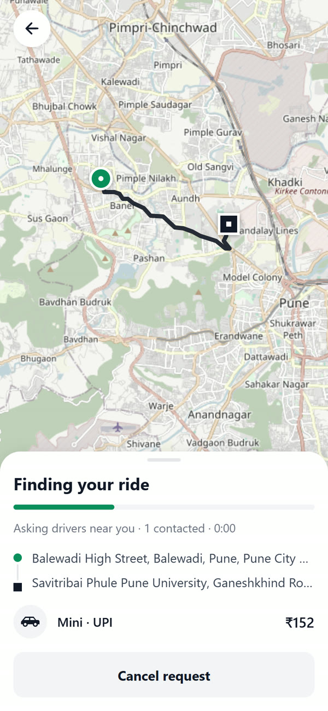<br>
      <b>R07 · Finding your ride</b><br>
      <sub>Searching: the rider sees how many drivers have been asked; one driver at a time gets 15 s to accept.</sub>
    </td>
  </tr>
</table>

#### 1.3 Live trip

<table>
  <tr>
    <td align="center" valign="top" width="25%">
      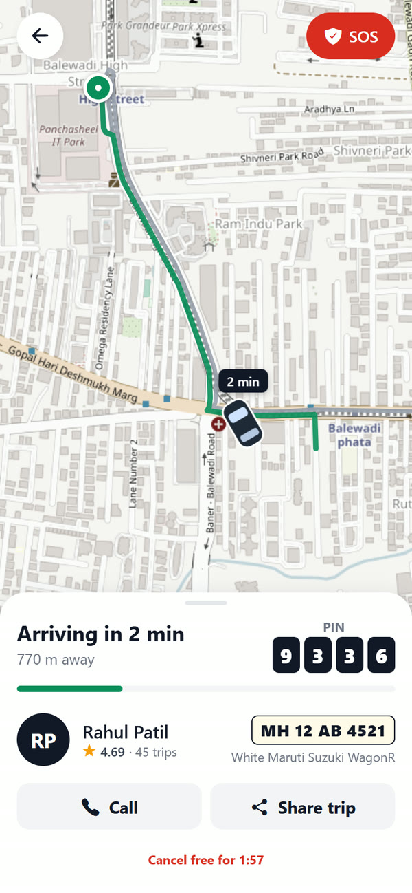<br>
      <b>R08 · Driver on the way</b><br>
      <sub>The rider sees the car move on the map with a live ETA and distance, the driver and plate, and the 4-digit PIN to start the trip.</sub>
    </td>
    <td align="center" valign="top" width="25%">
      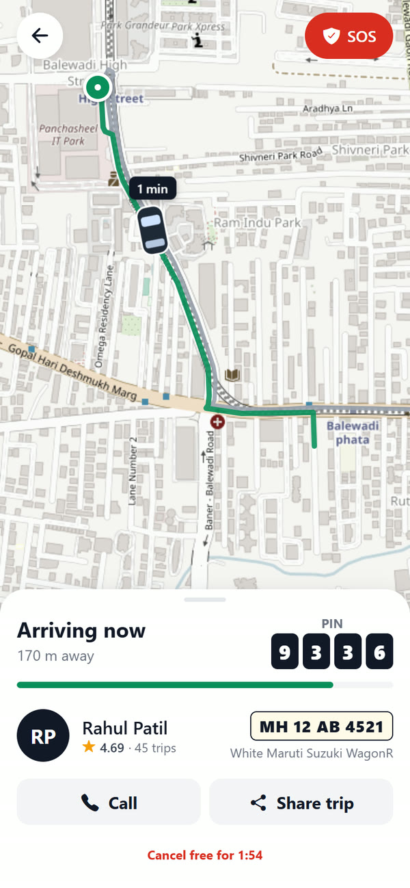<br>
      <b>R09 · Live tracking: the car approaches</b><br>
      <sub>Every GPS fix moves the car; distance left is measured along the road route, and the ETA counts down.</sub>
    </td>
    <td align="center" valign="top" width="25%">
      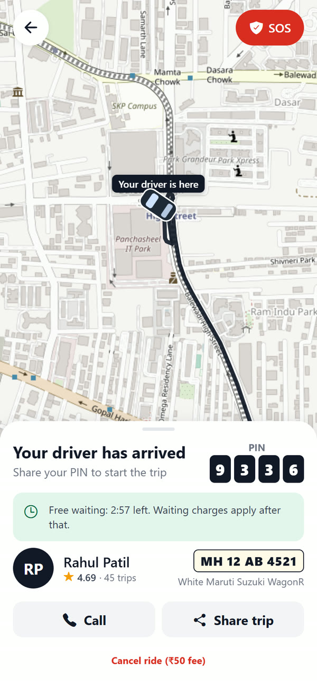<br>
      <b>R10 · Your driver has arrived</b><br>
      <sub>Arrival is only accepted within 250 m of the pickup. Free waiting counts down; waiting charges start after it.</sub>
    </td>
    <td align="center" valign="top" width="25%">
      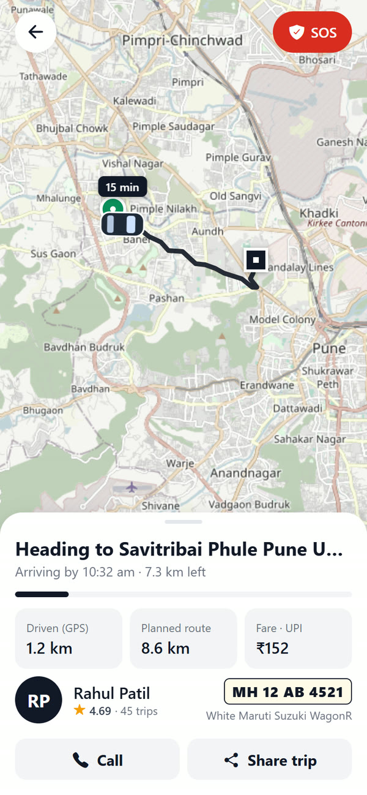<br>
      <b>R11 · On trip</b><br>
      <sub>Remaining distance and arrival time update live; the GPS-measured distance builds up next to the planned route. SOS is one tap away.</sub>
    </td>
  </tr>
</table>

#### 1.4 Receipt, rating and tip

<table>
  <tr>
    <td align="center" valign="top" width="25%">
      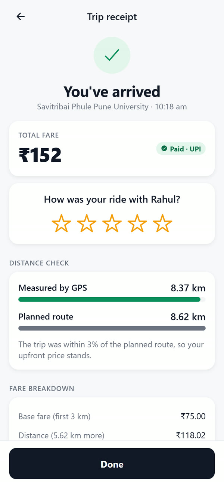<br>
      <b>R12 · Receipt</b><br>
      <sub>Total fare, paid by UPI, and the rating card.</sub>
    </td>
    <td align="center" valign="top" width="25%">
      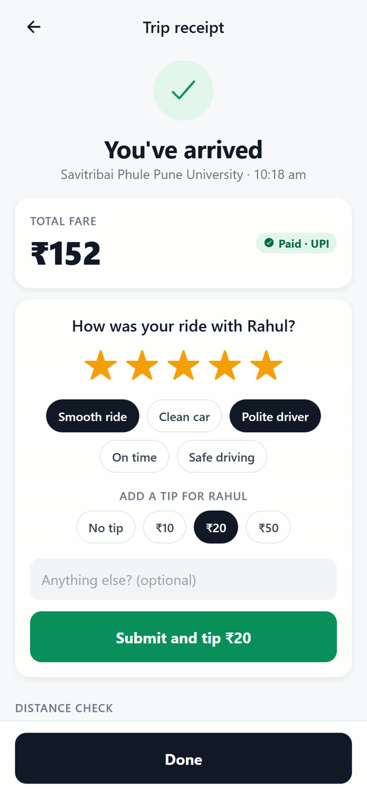<br>
      <b>R13 · Rate and tip</b><br>
      <sub>Stars, compliments and an optional tip that goes to the driver in full.</sub>
    </td>
    <td align="center" valign="top" width="25%">
      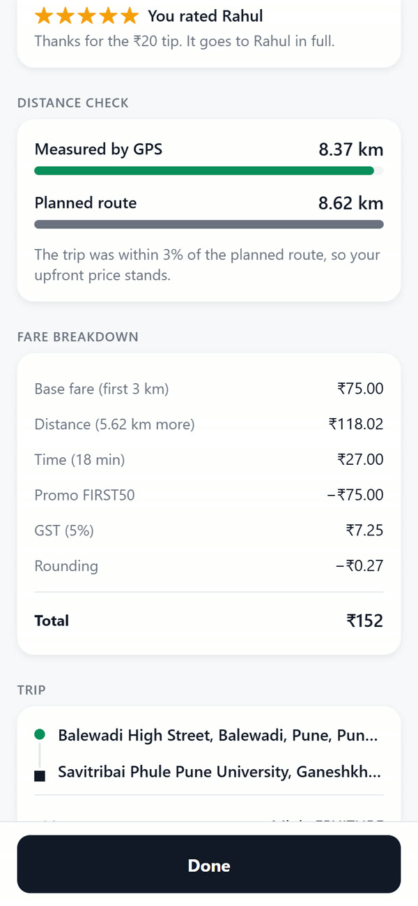<br>
      <b>R14 · Distance check</b><br>
      <sub>The GPS distance driven with the rider on board against the planned road route: within 20%, so the upfront price stands. Beyond it, the fare is recalculated from the GPS distance.</sub>
    </td>
    <td align="center" valign="top" width="25%">
      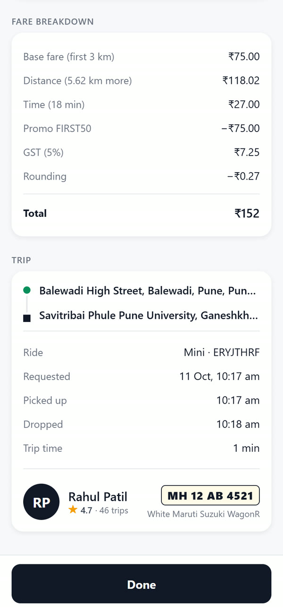<br>
      <b>R15 · Fare breakdown</b><br>
      <sub>Every line adds up to the total: base fare for the first 3 km, distance beyond it, time, the FIRST50 promo, 5% GST and rounding to whole rupees.</sub>
    </td>
  </tr>
</table>

#### 1.5 Ride history and wallet

<table>
  <tr>
    <td align="center" valign="top" width="50%">
      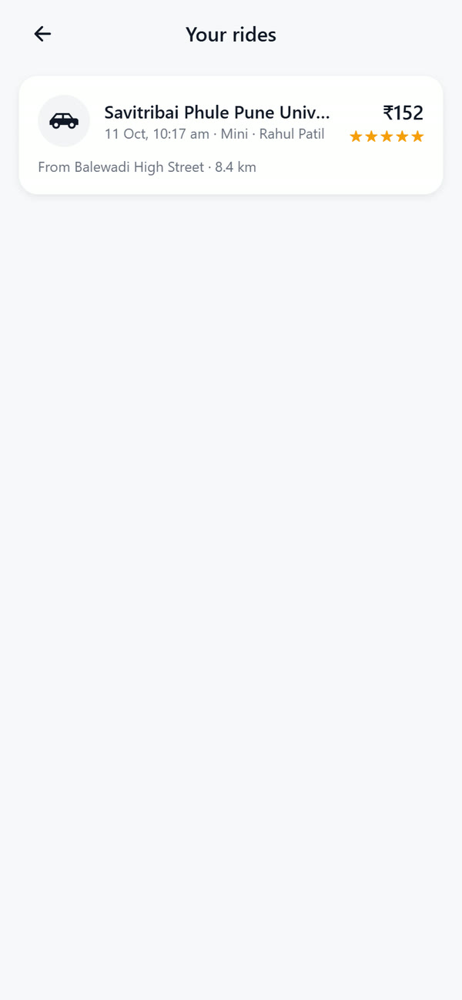<br>
      <b>R16 · Your rides</b><br>
      <sub>Every ride with its date, route, fare and status; tap one for its receipt.</sub>
    </td>
    <td align="center" valign="top" width="50%">
      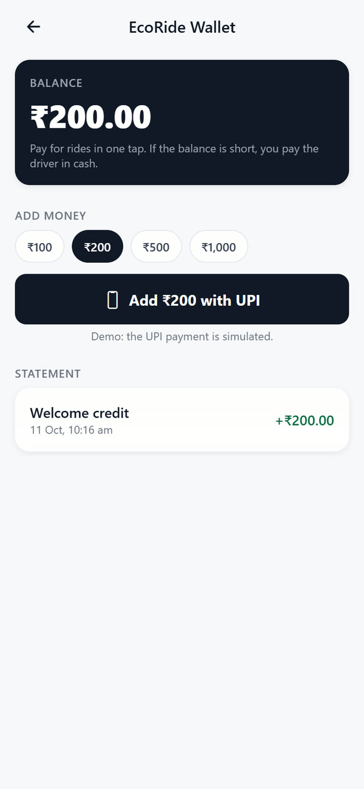<br>
      <b>R17 · Wallet</b><br>
      <sub>The wallet balance with the ₹200 welcome credit, quick UPI top-ups and the transaction list.</sub>
    </td>
  </tr>
</table>

<p align="right"><a href="#table-of-contents">Back to top ↑</a></p>

### 2. Driver app

A separate app with its own accounts. An approved driver goes online, accepts the request inside its 15-second window, drives to the pickup and the drop, starts with the rider's PIN and sees the earnings. Then a new driver applies and goes online once an admin approves.

<sub>15 steps · [watch the driver app video](docs/demo/video/ecoride-driver.mp4) (1:55)</sub>

#### 2.1 Sign in and go online

<table>
  <tr>
    <td align="center" valign="top" width="33%">
      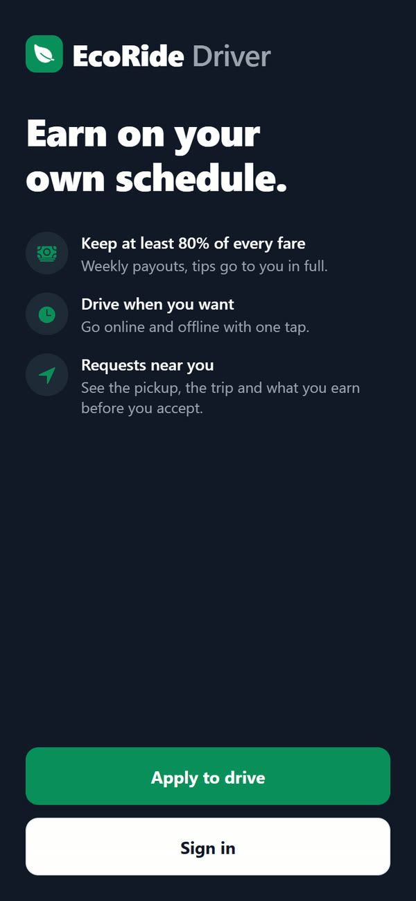<br>
      <b>D01 · Driver app welcome</b><br>
      <sub>The driver app is a separate app with its own sign-up (Apply to drive) and sign-in.</sub>
    </td>
    <td align="center" valign="top" width="33%">
      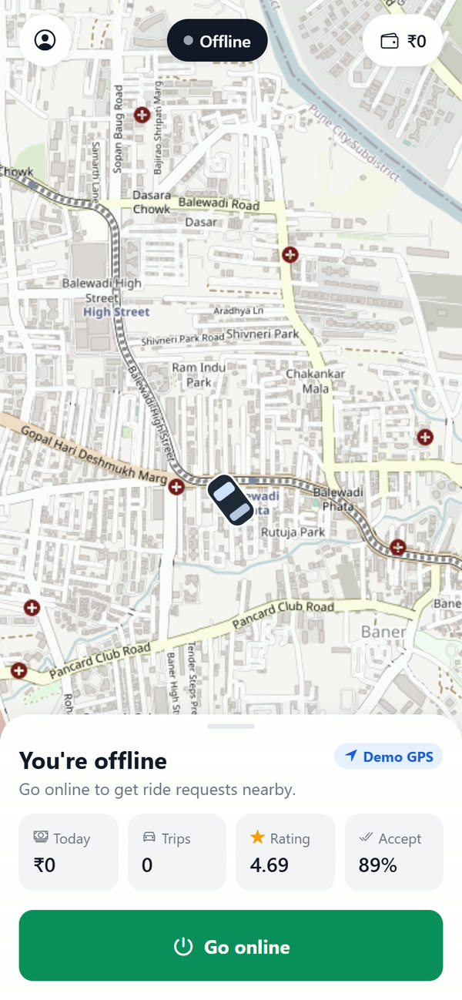<br>
      <b>D02 · Offline home</b><br>
      <sub>Signed in and offline: today's earnings, trips, rating and acceptance rate, and one big Go online button.</sub>
    </td>
    <td align="center" valign="top" width="33%">
      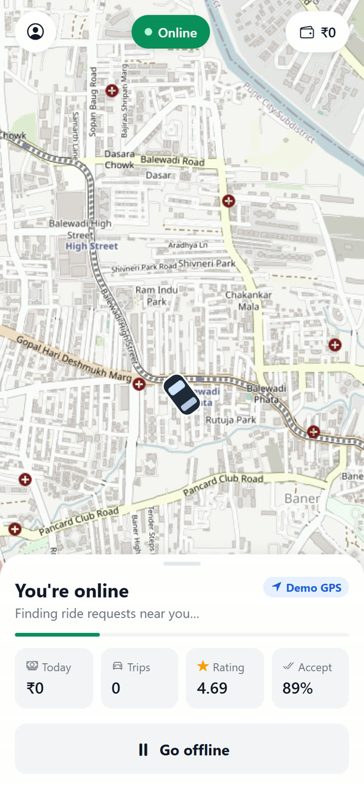<br>
      <b>D03 · Online and waiting for requests</b><br>
      <sub>Online: the cab's position goes to the server every second (simulated GPS in this laptop demo; real GPS on a phone).</sub>
    </td>
  </tr>
</table>

#### 2.2 Accept and drive to the pickup

<table>
  <tr>
    <td align="center" valign="top" width="50%">
      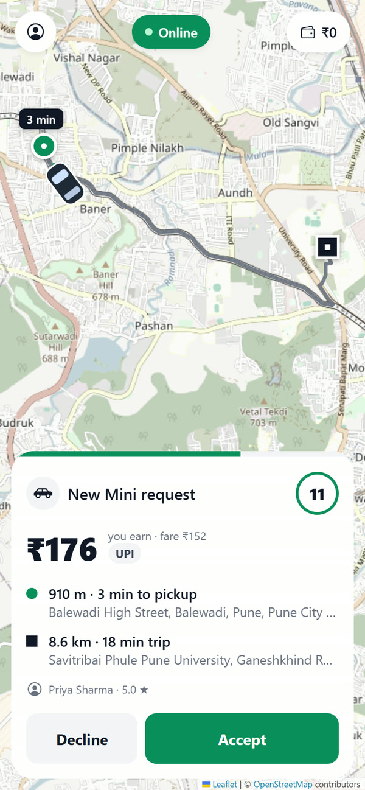<br>
      <b>D04 · Ride request with countdown</b><br>
      <sub>The request card: what the driver earns (80% of the fare), pickup distance and ETA, trip distance and time, payment method, rider rating, and a countdown ring.</sub>
    </td>
    <td align="center" valign="top" width="50%">
      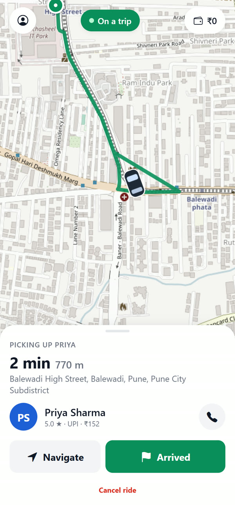<br>
      <b>D05 · Navigating to the pickup</b><br>
      <sub>Live distance and time to the pickup, measured along the road route; Navigate opens turn-by-turn directions; the rider's shared position shows too.</sub>
    </td>
  </tr>
</table>

#### 2.3 Start with the PIN and complete

<table>
  <tr>
    <td align="center" valign="top" width="33%">
      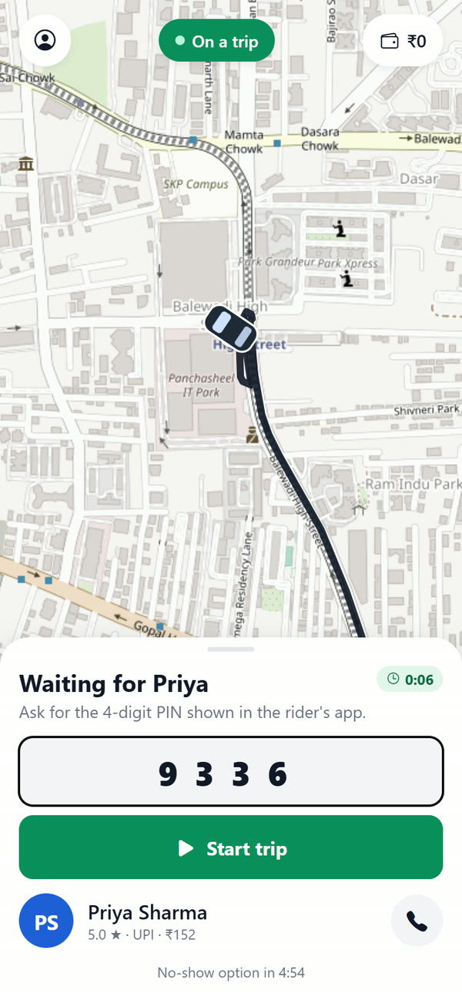<br>
      <b>D06 · Start with the rider's PIN</b><br>
      <sub>The trip starts only with the 4-digit PIN from the rider's app; a wrong PIN is refused.</sub>
    </td>
    <td align="center" valign="top" width="33%">
      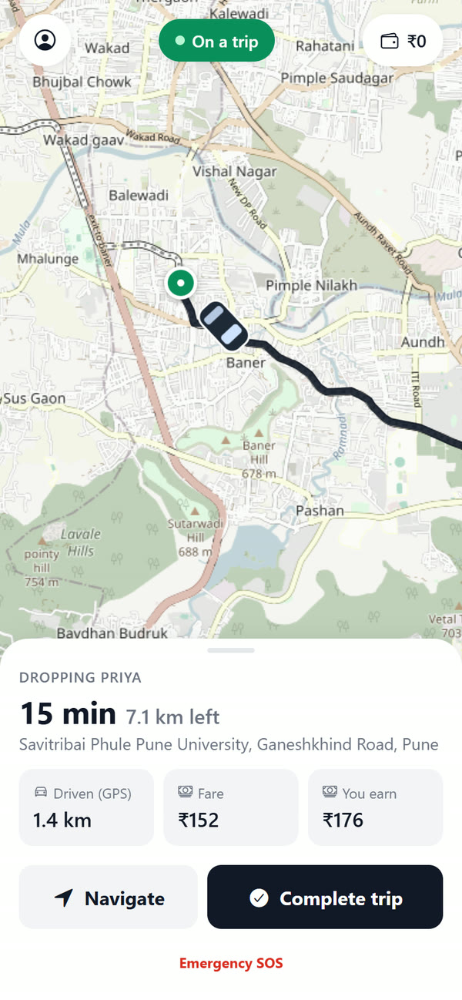<br>
      <b>D07 · Driving to the drop</b><br>
      <sub>The driver sees the distance left, the GPS distance so far, the fare and their earning.</sub>
    </td>
    <td align="center" valign="top" width="33%">
      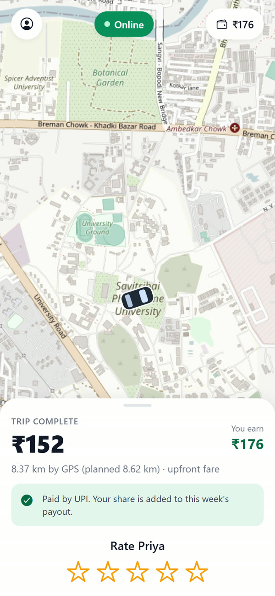<br>
      <b>D08 · Trip complete</b><br>
      <sub>GPS distance vs the planned route, the fare and the driver's share. UPI was charged automatically; with cash the driver confirms &quot;Cash collected&quot;.</sub>
    </td>
  </tr>
</table>

#### 2.4 Earnings and profile

<table>
  <tr>
    <td align="center" valign="top" width="50%">
      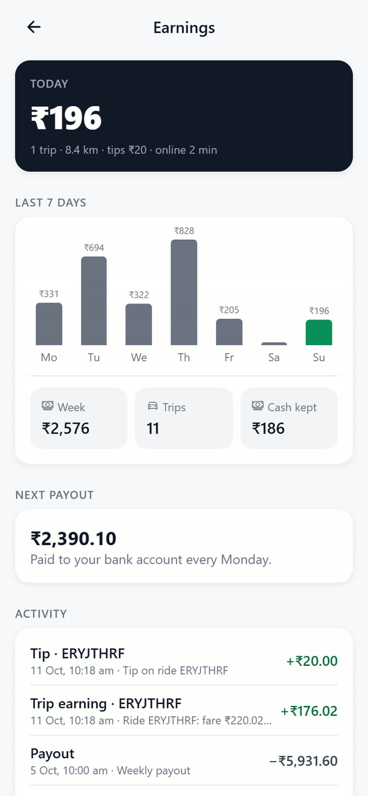<br>
      <b>D09 · Earnings</b><br>
      <sub>Today and the last 7 days, cash kept on cash rides, the Monday payout balance and the activity ledger (trip share, tip).</sub>
    </td>
    <td align="center" valign="top" width="50%">
      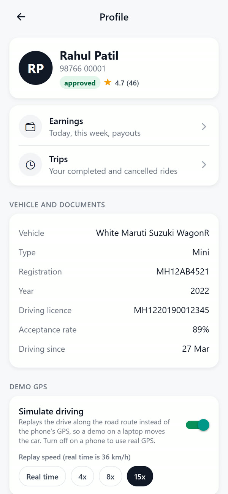<br>
      <b>D10 · Profile</b><br>
      <sub>The driver's vehicle, licence, rating and the Demo GPS setting (simulated drive on a laptop, real GPS on a phone).</sub>
    </td>
  </tr>
</table>

#### 2.5 A new driver applies and is approved

<table>
  <tr>
    <td align="center" valign="top" width="20%">
      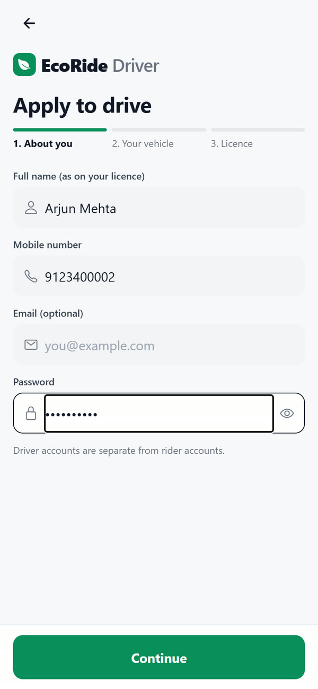<br>
      <b>D11 · Apply: about you</b><br>
      <sub>Step 1 of 3: name as on the licence, mobile number, optional email, password.</sub>
    </td>
    <td align="center" valign="top" width="20%">
      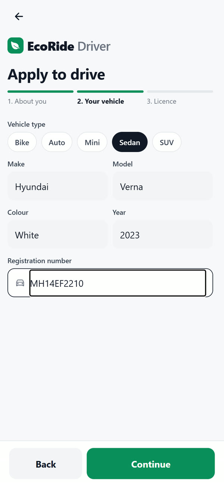<br>
      <b>D12 · Apply: your vehicle</b><br>
      <sub>Step 2: ride type, make, model, colour, year and registration number (checked for format and duplicates).</sub>
    </td>
    <td align="center" valign="top" width="20%">
      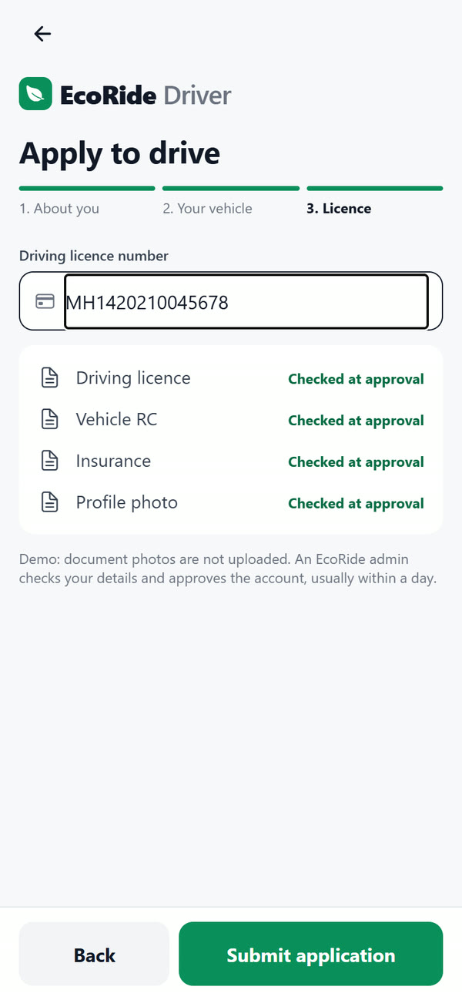<br>
      <b>D13 · Apply: licence and documents</b><br>
      <sub>Step 3: driving licence number; documents are checked by an admin at approval.</sub>
    </td>
    <td align="center" valign="top" width="20%">
      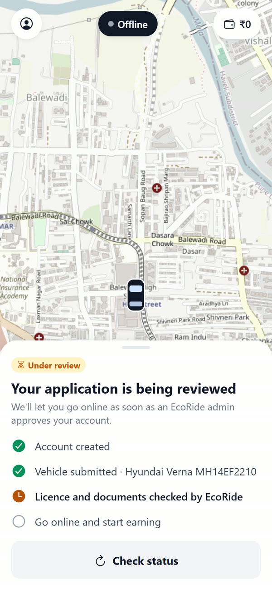<br>
      <b>D14 · Application under review</b><br>
      <sub>The applicant can sign in but cannot go online until an EcoRide admin approves the account.</sub>
    </td>
    <td align="center" valign="top" width="20%">
      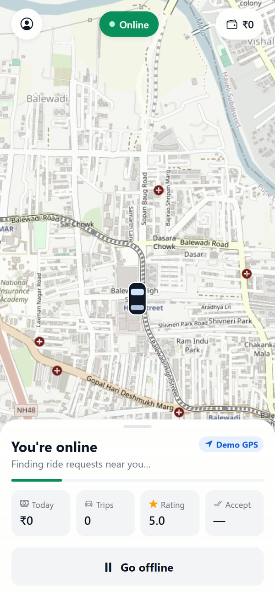<br>
      <b>D15 · Approved driver goes online</b><br>
      <sub>Once approved, the new driver goes online and starts receiving requests.</sub>
    </td>
  </tr>
</table>

<p align="right"><a href="#table-of-contents">Back to top ↑</a></p>

### 3. Admin console

The web console has complete access. It joins while the ride is in progress, then follows it through the ride's GPS trace and timeline, approves the new driver and changes fares, surge and settings, with every change in the audit log.

<sub>13 steps · [watch the admin console video](docs/demo/video/ecoride-admin.mp4) (1:14)</sub>

#### 3.1 Sign in and dashboard

<table>
  <tr>
    <td align="center" valign="top" width="50%">
      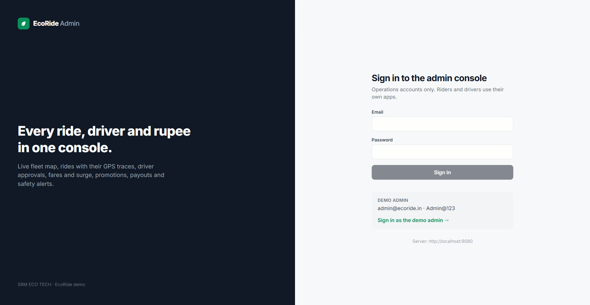<br>
      <b>A01 · Admin sign-in</b><br>
      <sub>A separate operations account signs in to the web console.</sub>
    </td>
    <td align="center" valign="top" width="50%">
      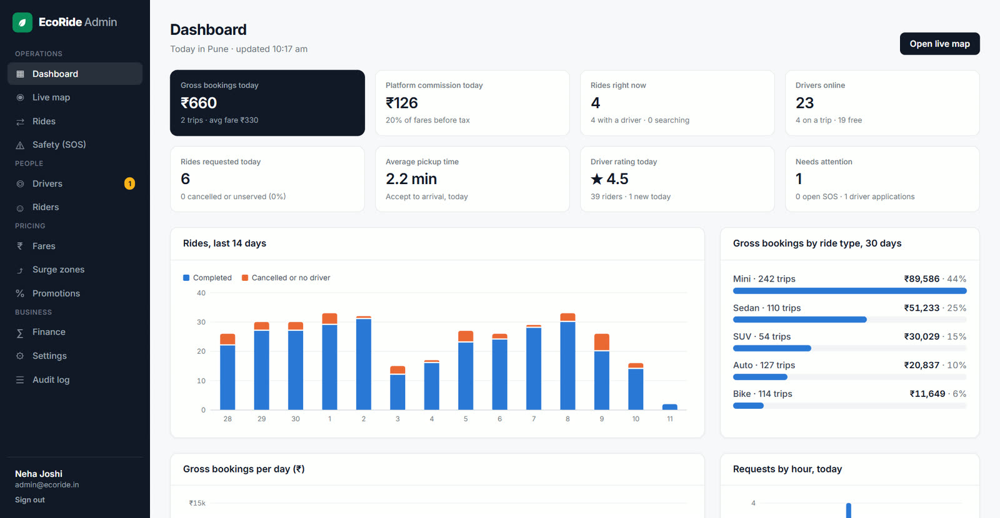<br>
      <b>A02 · Dashboard</b><br>
      <sub>Today's gross bookings and commission, rides right now, drivers online, pickup time, rating, plus 14-day trend, ride-type mix, hourly demand, latest rides, driver applications and SOS.</sub>
    </td>
  </tr>
</table>

#### 3.2 Live map

<table>
  <tr>
    <td align="center" valign="top" colspan="2">
      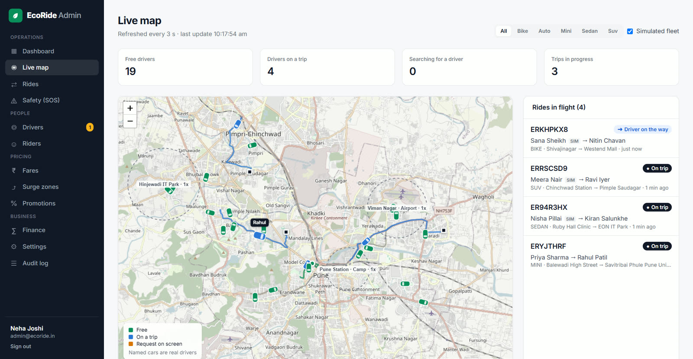<br>
      <b>A03 · Live map</b><br>
      <sub>Refreshed every 3 s. Rahul's car is on Priya's trip; named cars are real drivers, the rest is the simulated fleet that keeps the demo city busy.</sub>
    </td>
  </tr>
</table>

#### 3.3 Rides: GPS trace, timeline and dispatch

<table>
  <tr>
    <td align="center" valign="top" width="50%">
      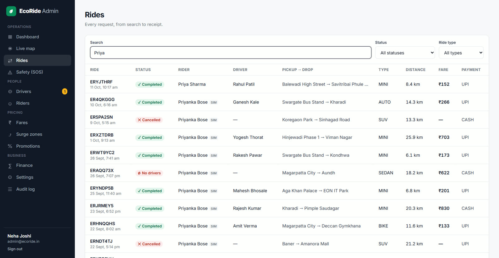<br>
      <b>A04 · Rides</b><br>
      <sub>Every ride with filters by status, type and text search.</sub>
    </td>
    <td align="center" valign="top" width="50%">
      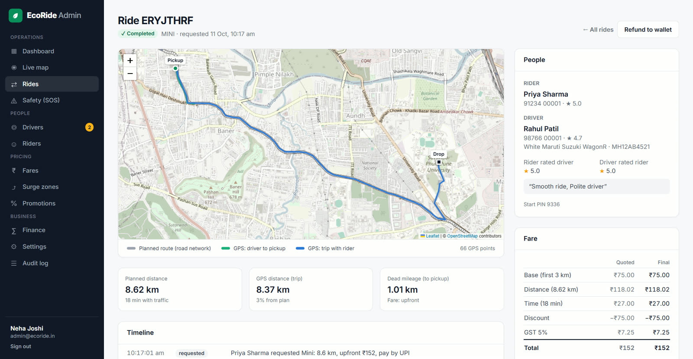<br>
      <b>A05 · Ride detail: planned route vs GPS trace</b><br>
      <sub>The planned road route (grey) against the GPS trace to the pickup (green) and with the rider (blue), with planned, GPS and dead-mileage distances, the people and the fare quoted vs final.</sub>
    </td>
  </tr>
  <tr>
    <td align="center" valign="top" colspan="2">
      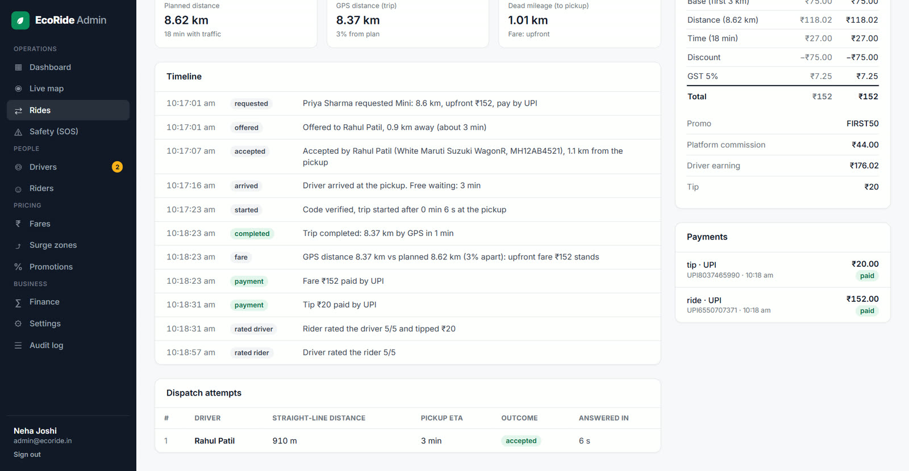<br>
      <b>A06 · Ride timeline and dispatch</b><br>
      <sub>Every event with its time (request, offer, accept, arrival, PIN start, fare check, payment, ratings) and each dispatch attempt with distance and answer time.</sub>
    </td>
  </tr>
</table>

#### 3.4 Driver approval

<table>
  <tr>
    <td align="center" valign="top" width="50%">
      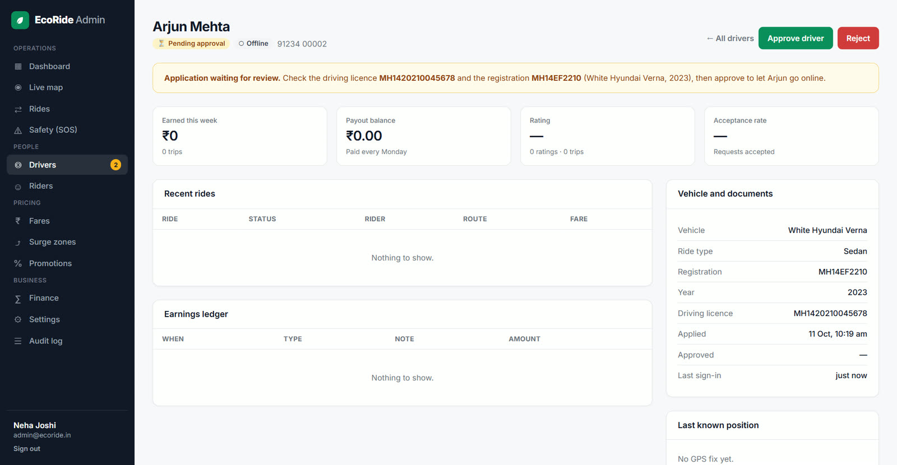<br>
      <b>A07 · Driver application</b><br>
      <sub>The applicant's licence and vehicle, ready to approve or reject (with a reason).</sub>
    </td>
    <td align="center" valign="top" width="50%">
      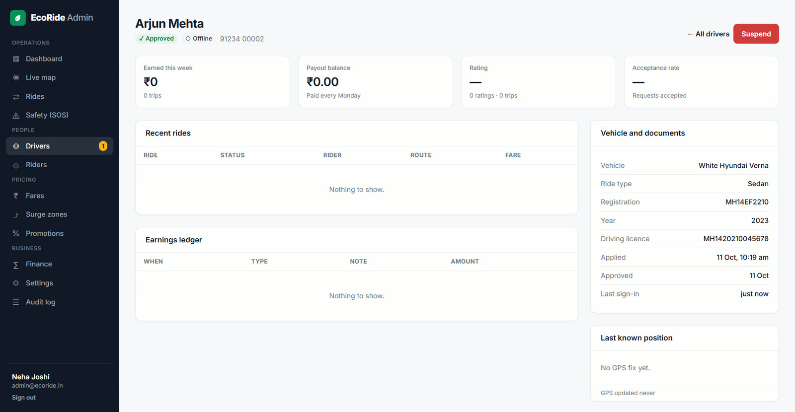<br>
      <b>A08 · Driver approved</b><br>
      <sub>Approved: the driver can go online at once. Suspend, take offline and pay out are on the same page.</sub>
    </td>
  </tr>
</table>

#### 3.5 Fares and surge

<table>
  <tr>
    <td align="center" valign="top" width="50%">
      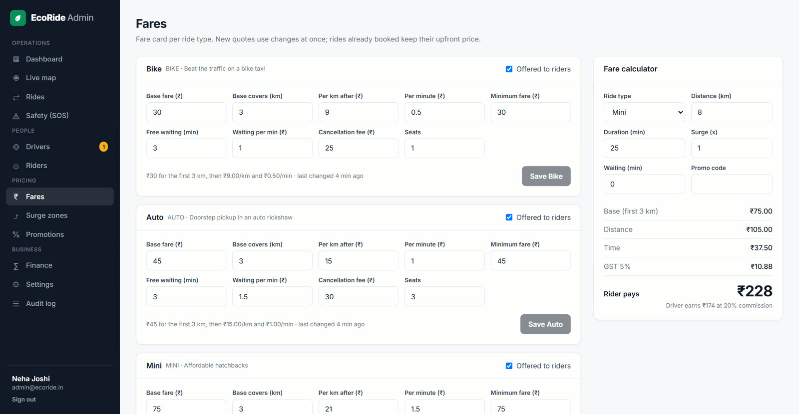<br>
      <b>A09 · Fares</b><br>
      <sub>Base fare covering the first 3 km, per km, per minute, minimum fare, free waiting, waiting charge and cancellation fee for each product.</sub>
    </td>
    <td align="center" valign="top" width="50%">
      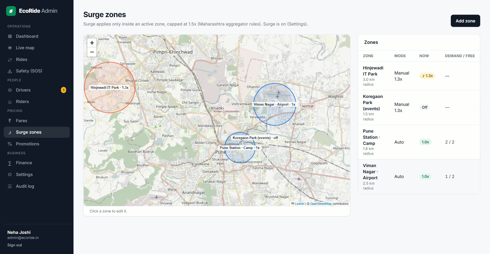<br>
      <b>A10 · Surge zones</b><br>
      <sub>A manual 1.3x surge set on the Hinjewadi IT Park zone; riders booking there now see the surged upfront fare.</sub>
    </td>
  </tr>
</table>

#### 3.6 Finance, settings and audit

<table>
  <tr>
    <td align="center" valign="top" width="50%">
      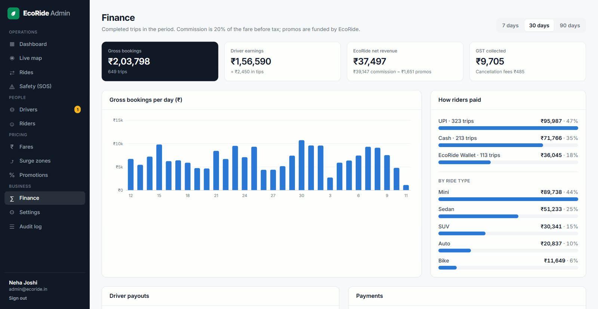<br>
      <b>A11 · Finance</b><br>
      <sub>Totals for the period, gross bookings per day, how riders paid, ride-type mix, driver payout balances and every payment.</sub>
    </td>
    <td align="center" valign="top" width="50%">
      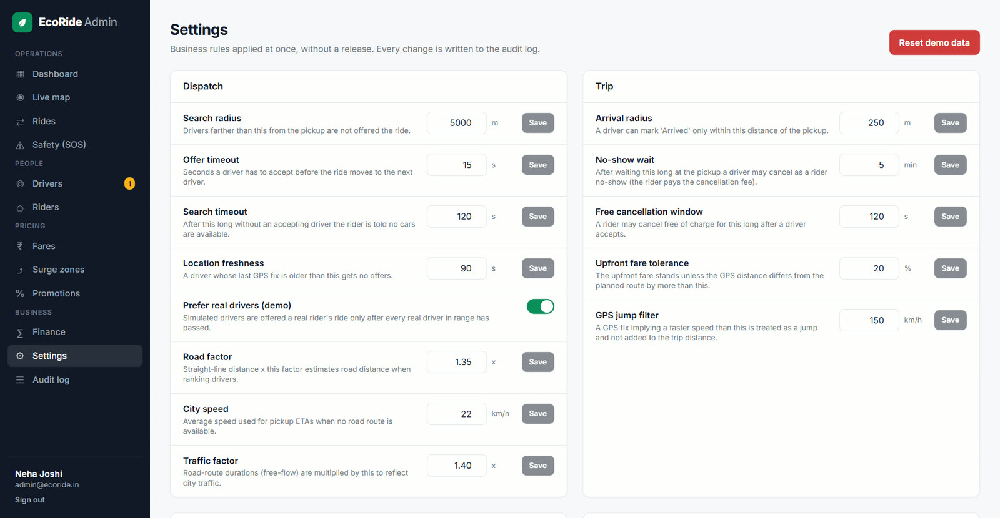<br>
      <b>A12 · Settings</b><br>
      <sub>Each rule with its bounds; changes apply at once and are audited. Reset demo data rebuilds the demo.</sub>
    </td>
  </tr>
  <tr>
    <td align="center" valign="top" colspan="2">
      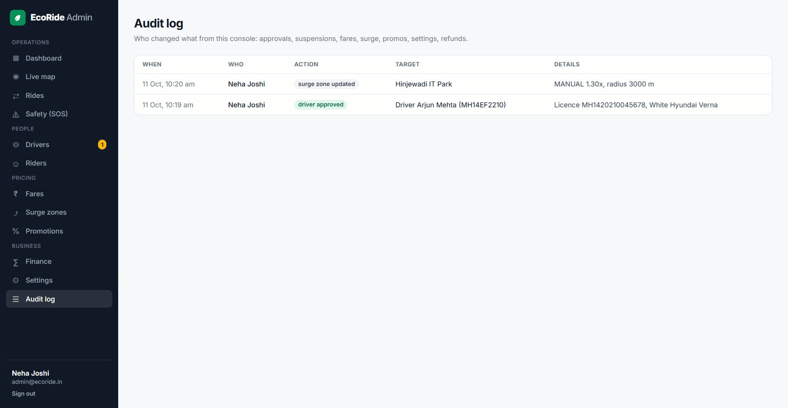<br>
      <b>A13 · Audit log</b><br>
      <sub>Who approved the driver and changed the surge zone, and when.</sub>
    </td>
  </tr>
</table>

<p align="right"><a href="#table-of-contents">Back to top ↑</a></p>

---

## How a ride works

1. **Pickup from GPS.** The rider app reads the phone's location (outside Pune, the demo places the rider at Balewadi High Street) and names it by reverse geocoding.
2. **Upfront quote.** The backend plans the road route (OSRM), applies the traffic factor, checks surge at the pickup and any promo, and prices every ride type. The quote is held for 5 minutes, so the price the rider accepts is the price on the ride.
3. **Dispatch.** The ride is offered to **one driver at a time, nearest first**, among free, approved drivers of that type with a fresh GPS fix within 5 km. Each has **15 s** to accept; a decline or timeout moves it on. After 120 s the rider is told no cars are free. A single dispatcher thread means a driver never holds two offers.
4. **Live distances.** Every GPS fix from the driver app is snapped onto the planned road route; the rider sees the distance and ETA *left along the road*, not as the crow flies. The rider shares their own position with the driver while waiting.
5. **Arrival and PIN.** "Arrived" is accepted only within 250 m of the pickup. The trip starts only with the rider's 4-digit PIN. Free waiting (3–5 min by type), then a per-minute waiting charge.
6. **GPS odometer.** With the rider on board, fixes add up the distance actually driven (jumps faster than 150 km/h, poor-accuracy fixes and sub-5 m jitter are ignored).
7. **Final fare.** The upfront fare stands if the GPS distance is within **±20 %** of the planned route (plus any waiting charge); otherwise it is recalculated from the GPS distance and actual time. Payment by UPI (simulated collect), wallet (falls back to cash if short) or cash (the driver confirms collection).
8. **Money.** The driver keeps **80 %** of the fare before tax, tips in full; EcoRide keeps 20 % and funds promos. Every amount lands in the driver's ledger; payouts are made from the console.

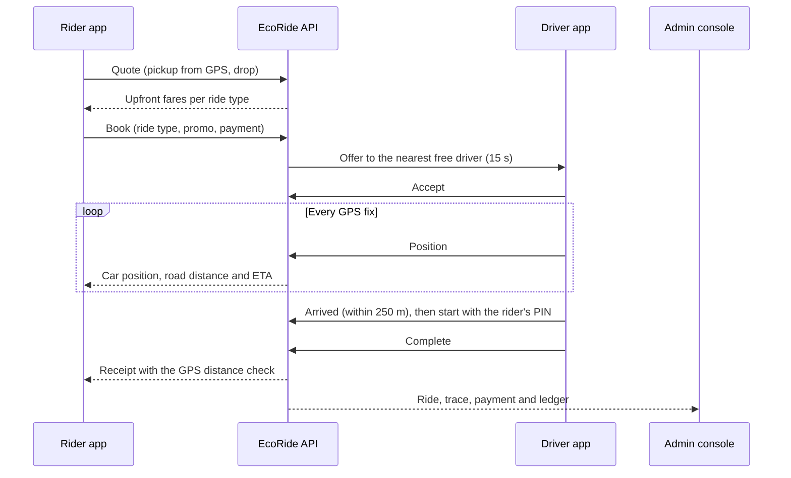

### Market rules applied

Researched from current Indian practice (October 2026):

- **MoRTH Motor Vehicle Aggregator Guidelines 2025**: the base fare covers the first 3 km; drivers receive at least 80 % of the fare; a driver cancelling without cause pays 10 % of the fare, capped at ₹100; surge up to 2× nationally.
- **Maharashtra rules**: surge capped at **1.5×** the base fare (EcoRide's default `SURGE_CAP`).
- **Ride-hailing practice**: upfront pricing, sequential offers with a short accept window (10–15 s), free cancellation for a couple of minutes after acceptance, a cancellation fee after that or for a no-show, waiting charges after a free wait, 5 % GST on rides.

Every one of these numbers is a **setting** the admin console changes without a release.

---

## Quick start

### Prerequisites

| Tool | Version |
|---|---|
| Java | 21 |
| Maven | 3.9+ |
| MySQL | 8.x on `localhost:3306`, user `root` / `root` (database `ecoride` is created automatically) |
| Node.js | 22.13+ (22.12 works with engine warnings) |
| Phone (optional) | **Expo Go** (SDK 57) on the same Wi-Fi as the laptop |

### 1 · Backend (port 9080)

```bash
cd backend
mvn -DskipTests package
java -jar target/ecoride-api.jar
```

Every start **drops, recreates and reseeds** the database (`DB_INIT_MODE=always`): demo accounts, 44 Pune places, fare cards, promos, surge zones, 25 drivers and 30 days of ride history. Set `DB_INIT_MODE=never` to keep data. Swagger UI: http://localhost:9080/swagger-ui.html

A **simulated fleet** (22 drivers, about 36 riders) keeps the city alive: simulated drivers cruise real roads, and simulated riders book every ~40 s. Simulated rides go only to simulated drivers. A real rider's request reaches a simulated driver only when no real driver nearby accepts. Turn it off with `DEMO_SIMULATION=false` or in Settings.

### 2 · Apps, from the `ecoride/` folder

```bash
npm install                 # once: installs all three apps and the shared packages (npm workspaces)

npm run rider               # Expo for the rider app   (press w for web, or scan the QR with Expo Go)
npm run driver              # Expo for the driver app
npm run admin               # Vite dev server for the admin console: http://localhost:5174
```

The apps find the API by themselves: in the browser they call the page's host on port 9080; in Expo Go they call the laptop running Metro. To point elsewhere, set `EXPO_PUBLIC_API_URL` (apps) or `VITE_API_URL` (admin).

**Production-style web builds** (what the demo recording uses):

```bash
npm run build:web           # exports both apps and builds the admin console
npm run serve:web           # rider http://localhost:9081 · driver http://localhost:9082 · admin http://localhost:9083
```

**On a laptop**, the driver app's *Demo GPS* (on by default on web) drives the cab along the road route, 8× real time; change the speed or switch to real GPS in the driver app's Profile. To test the rider app's GPS in Chrome: DevTools → Sensors → Location → e.g. `18.5705, 73.7745` (Balewadi High Street).

## Demo accounts

| App | Sign in | Password | Who |
|---|---|---|---|
| Rider | `9876500001` | `Rider@123` | Ananya Rao (₹500 wallet, Home and Work saved) |
| Rider | `9876500002` | `Rider@123` | Rohan Mehta |
| Driver | `9876600001` | `Driver@123` | Rahul Patil, Mini, MH12AB4521 (approved, starts offline near Baner) |
| Driver | `9876600002` | `Driver@123` | Sandeep Kulkarni: application **pending approval** |
| Driver | `9876600003` | `Driver@123` | Imran Shaikh: **suspended** (insurance expired) |
| Admin | `admin@ecoride.in` | `Admin@123` | Neha Joshi (full access) |

Promo codes: `FIRST50` (50 % off the first ride, up to ₹75), `ECO20` (20 %, up to ₹60, 5 rides), `WEEKEND25` (₹25 off above ₹150).

---

## Testing

```bash
cd backend && mvn test            # 35 tests: fares, polyline/route tracking, full ride lifecycle,
                                  # dispatch cascade, cancellations, no-show, GPS filtering,
                                  # role separation, concurrency (needs MySQL; uses ecoride_test)
node scripts/smoke.mjs            # 53 API checks of the whole journey against a running API
npm run typecheck                 # strict TypeScript for all three apps
```

Database invariants (`backend/src/main/resources/schema.sql`): one ride in flight per rider and one assigned ride per driver (unique keys on generated columns), one open offer per ride, only approved drivers online, valid statuses, ratings and fare-card values.

## Project structure

```
ecoride/
├── backend/            Spring Boot API (common · geo · pricing · rider · driver · ride · admin · demo)
├── apps/rider/         Expo rider app            (src/app = screens, src/lib = API, queries, booking, position)
├── apps/driver/        Expo driver app           (src/lib/gps.ts = real GPS or the route simulator)
├── apps/admin/         React + Vite admin console (src/pages)
├── packages/core/      API types, client, polyline/geo, formatting (shared by all three apps)
├── packages/mobile/    UI kit, live map (Leaflet on web, react-native-maps on phones), location, auth
├── scripts/            smoke.mjs (API journey), serve-web.mjs (serve the web builds)
└── docs/
    ├── architecture.md components, dispatch, fares, concurrency decisions, API map
    └── demo/           step-by-step demo page, screenshots (img/) and the three videos (video/)
```

More detail: [`docs/architecture.md`](docs/architecture.md).

## Known limitations

- Payments are simulated (UPI collect, wallet top-ups and payouts).
- The apps refresh by polling every 2–3 seconds rather than by push notifications.
- Maps, routing and place search use free OpenStreetMap services with fair-use limits; without them the backend falls back to straight-line estimates and a built-in list of Pune places.
- A simulated fleet of 22 drivers keeps the demo city busy. It never takes a real rider's request while a real driver nearby is available.

## Acknowledgements

Map data © [OpenStreetMap](https://www.openstreetmap.org/copyright) contributors · routing by [OSRM](https://project-osrm.org/) · place search by [Nominatim](https://nominatim.org/).
